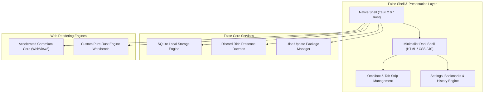

<div align="center">

# false

**A fast, quiet, distraction-free web browser built in Rust.**

[](https://github.com)
[](https://www.rust-lang.org/)
[](LICENSE)
[](https://microsoft.com/windows)

<p align="center">
  Developed solely by <b>zaidi</b>
</p>

</div>

---

## Overview

**False** is a modern, privacy-respecting browser that pairs a custom pure-Rust rendering workbench with a fine-tuned, hardware-accelerated WebView2 engine. Designed from the ground up to eliminate browser bloat, unwanted distractions, and noisy background services.

### Key Highlights

- **Blazingly Fast**: Zero unnecessary network proxy hops, full HTTP/2, HTTP/3 (QUIC), and TLS 1.3 0-RTT support.
- **Hardware-Accelerated Rendering**: Out-of-process canvas rasterization, GPU-accelerated 2D canvas, and multi-threaded raster pipelines.
- **Minimalist Dark UI**: Layered dark palettes (`#09090b`, `#121215`), high-density zero-bloat layouts, and subtle 1px border styling.
- **Instant Standalone Installer**: Single GUI binary (`FalseSetup.exe`) with native Windows shortcuts, Control Panel registration, and zero console popups.
- **Modular Update Packages (`.flse`)**: Seamless, self-contained update packages allowing instant runtime updates.
- **Discord Rich Presence**: Optional status display showing your active browsing activity without compromising privacy or leaking visited URLs.

---

## Architecture



---

## Crates & Repository Structure

| Crate | Purpose |
| :--- | :--- |
| [`crates/false-ui`](crates/false-ui) | Tauri 2.0 native window shell, GUI installer/uninstaller, and frontend workbench |
| [`crates/false-core`](crates/false-core) | Core data structures, configuration state, and session persistence |
| [`crates/false-net`](crates/false-net) | High-throughput asynchronous networking, connection pooling, and DNS caching |
| [`crates/false-dom`](crates/false-dom) | Pure-Rust HTML parser and DOM tree construction |
| [`crates/false-css`](crates/false-css) | CSS tokenization, parser, cascade computation, and rule matching |
| [`crates/false-layout`](crates/false-layout) | Box tree layout generator, flexbox/block formatting context calculator |
| [`crates/false-render`](crates/false-render) | Software and hardware rendering rasterizer |
| [`crates/false-engine`](crates/false-engine) | Unified browser engine orchestrating layout, rendering, and DOM updates |

---

## Getting Started

### Installation

Download the latest installer from the Releases section:

1. Run **`FalseSetup.exe`**.
2. Customize your install directory or desktop shortcut options.
3. Click **Install**. False will be registered in your Windows Start Menu, Desktop, and Control Panel automatically.

### Manual Build from Source

Prerequisites:
- [Rust](https://rustup.rs/) (edition 2021+)
- Windows 10 / 11 with WebView2 Runtime

```powershell
# Clone the repository
git clone https://github.com/zaidi/false.git
cd false

# Build the complete release package
.\build_package.ps1 -Version "0.1.0"
```

The build script will produce:
- `FalseSetup.exe`: Standalone GUI installer
- `false-v0.1.0.flse`: Modular update package

---

## License

Copyright &copy; 2026 **zaidi**. All rights reserved.
See [LICENSE](LICENSE) for full legal terms.
